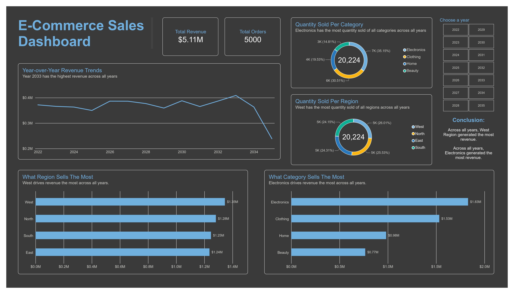

### E-Commerce Sales Analysis

---

Exploratory data analysis of the e-commerce sales dataset using SQL and BigQuery.

This project analyzes sales transactions across all years to uncover sales revenue trends, sales revenue performance by region and category, sales volume performance by region and category.

##### Key analysis include:

- Sales revenue trend across all years
- Sales revenue performance across category and region 
- Sales volume performance across category and region

##### Tools used:

SQL, BigQuery, PowerBI

##### Dashboard Image:

